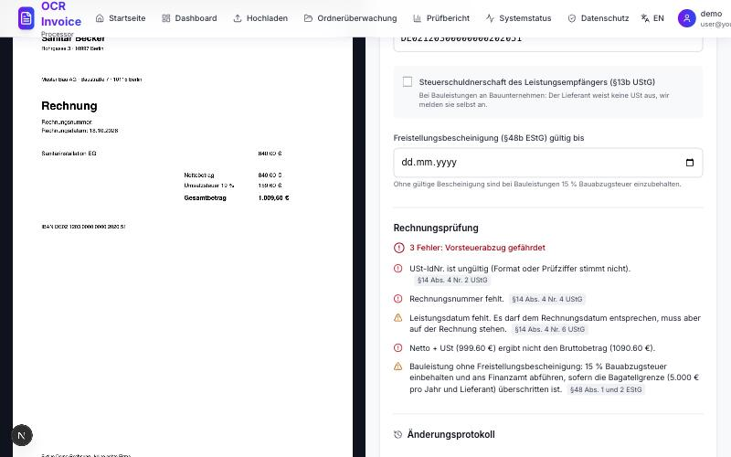
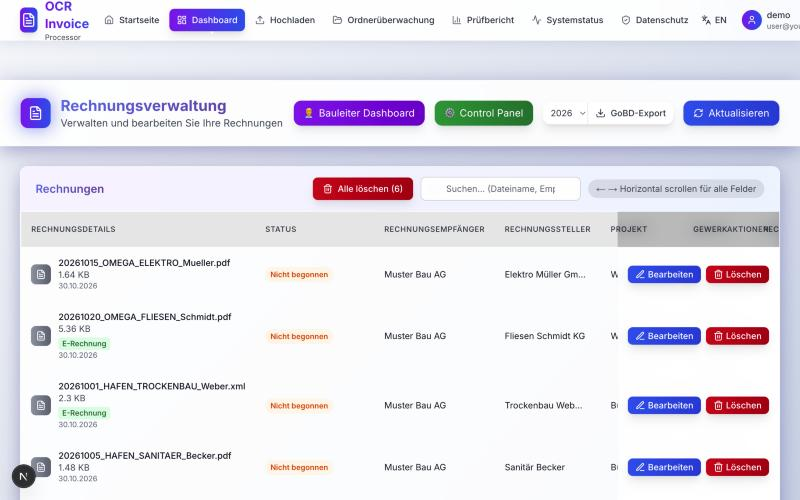
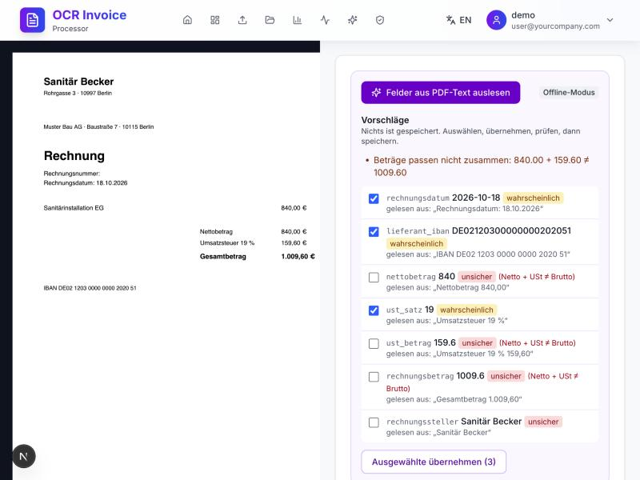

# Invoice Workflow Platform

**Accounts payable for German construction companies that is compliant by design:** e-invoices in, checked against German tax law, approved by the site manager, kept audit-proof for eight years.

[](https://github.com/Milan4321123/invoice-workflow-platform/actions/workflows/ci.yml)



## Try it in one command

```bash
./start-demo.sh
```

Open http://localhost:3000 and log in as **`demo` / `Demo-2026!`**. Demo mode runs on an in-memory database with six fictional invoices, each showing one feature. No Supabase or e-mail account is needed, nothing is saved, and e-mails are written to `backend/outbox/` instead of being sent.

## What it does

| Area | What you get | Legal basis |
|---|---|---|
| **E-invoices** | XRechnung (UBL, CII) and ZUGFeRD/Factur-X are read from the XML, the legally binding part, and prefill the invoice. External XML is parsed with `defusedxml` (no XXE). | §14 UStG, EN 16931 |
| **Invoice check** | Live while editing: mandatory details, VAT ID check digit, IBAN, net + VAT = gross, small-invoice rules, reverse charge, construction withholding tax, duplicate invoice numbers. Each finding cites its paragraph. | §14 UStG, §33 UStDV, §13b UStG, §48 EStG |
| **Approval & Skonto** | Signed, single-use approval links for site managers; reminders to accounting before early-payment discounts expire. | |
| **Audit-proof records** | Append-only, hash-chained change log with old/new value per field; lock after approval; deletion refused during the 8-year retention; ZIP export for tax auditors. | GoBD, §147 AO |
| **Privacy** | Every data route authenticated; no third-party requests from the browser; e-mails and IBANs masked in logs; IP addresses removed after 30 days; access and erasure requests in the app. | DSGVO Art. 5, 15, 17, 32; TDDDG §25 |
| **Accessibility & language** | WCAG 2.1 AA, zero axe-core violations on login, dashboard and editor; German/English UI. | EN 301 549 |



## AI features

**AI proposes, rules verify, people decide.** Four features, built on Claude (`claude-opus-5-5`), all of them working offline without a key:

| Feature | What it does |
|---|---|
| **AP assistant** (agent) | Answers "which Skonto expires this week?" or "what's wrong with Becker's invoice?" by calling the platform's own functions. It can *propose* a change; a person applies it through the normal GoBD-checked save. |
| **Tax-rule Q&A** (RAG) | Answers from the statutes (UStG, UStDV, EStG, AO), stored verbatim from gesetze-im-internet.de, with a citation for every statement. |
| **Field extraction** | Reads PDFs without e-invoice XML; every value comes with a confidence and the text it was read from, and is re-checked by the deterministic rules. |
| **Correction request** | Drafts the e-mail asking a supplier for a corrected invoice. Never sent automatically. |

Guardrails (no acting tools, prompt-injection handling, masked IBANs, step limits, usage and cost log without content, AI involvement in the GoBD log, EU AI Act labelling) and the extraction eval: [docs/architecture/ai.md](docs/architecture/ai.md).



## Why this project exists

German accounts payable is changing: e-invoice receiving has been mandatory since January 2025, issuing follows in 2027/2028, receipts must be kept for 8 instead of 10 years, and the EU's ViDA package makes EN 16931 e-invoicing mandatory for intra-EU trade from 2030. The research behind the features, with sources, is in [docs/research/market-and-regulation.md](docs/research/market-and-regulation.md).

## Architecture

Next.js 15 frontend, FastAPI backend, Supabase (Postgres + private storage, EU region). Every invoice write goes through one method that enforces the GoBD rules and appends to the audit log. Diagram and design decisions: [docs/architecture/overview.md](docs/architecture/overview.md).

```
backend/
  services/e_invoice.py           XRechnung / ZUGFeRD parser (EN 16931)
  services/invoice_compliance.py  §14 UStG, §13b, §48 EStG rules (pure functions)
  services/audit.py               hash-chained change log
  services/gobd.py                retention, lock after approval
  services/privacy_service.py     data subject requests, IP retention
  services/log_redaction.py       no e-mails or IBANs in logs
  services/ai/                    agent, RAG over statutes, extraction, correction drafts
  evals/                          extraction accuracy on invoices with known values
  tests/                          280+ tests, no network or API key needed
frontend/src/
  components/compliance/          tax details, live check, change history
  i18n/                           typed DE/EN dictionaries
database/migrations/              versioned schema changes
docs/                             research, architecture, compliance, pitch
```

## Running it for real

1. Create a Supabase project in an EU region and run [`COMPLETE_SUPABASE_SETUP.sql`](COMPLETE_SUPABASE_SETUP.sql) in its SQL editor. Existing installations instead apply the files in [`database/migrations/`](database/migrations/) in order.
2. `cp environment.template .env` and fill in Supabase keys, a JWT secret (`openssl rand -base64 64`), the admin account, the e-mail provider and the company details for the Impressum.
3. Start with Docker (`./start-company.sh`, or `start-company.bat` on Windows) and open http://localhost:3000.

Setup and deployment guides: [docs/setup](docs/setup/) · [docs/deployment](docs/deployment/).

## Development

```bash
cd backend && python -m venv .venv && .venv/bin/pip install -r requirements.txt && .venv/bin/python -m pytest -q
cd frontend && npm ci && npm run lint && npx tsc --noEmit && npm run build
```

CI runs both on every push and pull request.

## Compliance documentation

- [GoBD procedure documentation (Verfahrensdokumentation)](docs/compliance/gobd-verfahrensdokumentation.md)
- [DSGVO: record of processing, TOM, deletion concept](docs/compliance/dsgvo.md)
- [Accessibility statement](docs/compliance/accessibility.md)

These are templates for an operating company; parts marked **[zu ergänzen]** depend on its organisation. They are not legal advice.

## Roadmap

DATEV booking export · KoSIT validator for XRechnung · roles (AP clerk, approver, privacy officer) · transactional audit logging via database trigger · VIES lookup for foreign VAT IDs · live extraction eval on a held-out set of real (anonymised) invoices · hybrid retrieval once the knowledge base includes BMF letters.
