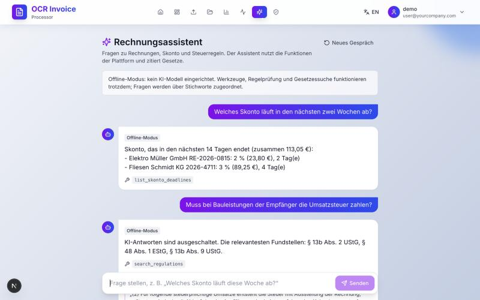

# AI features

Four features, one rule: **AI proposes, rules verify, people decide.**

| Feature | What it does | Where |
|---|---|---|
| **Field extraction** | Reads a PDF invoice without e-invoice XML and suggests field values, each with a confidence and the text it was read from | `backend/services/ai/extraction.py`, editor panel |
| **Regulation Q&A (RAG)** | Answers questions about the tax rules from the statutes, citing the paragraph | `backend/services/ai/retrieval.py`, `rag.py` |
| **AP assistant (agent)** | Answers questions about invoices and Skonto by calling the platform's own functions; can propose, never perform, changes | `backend/services/ai/agent.py`, `/assistent` |
| **Correction request** | Drafts the e-mail asking a supplier for a corrected invoice from the compliance findings | `backend/services/ai/correction.py`, checklist button |



## Live and offline

| | Live | Offline |
|---|---|---|
| When | `AI_FEATURES_ENABLED=true` **and** `ANTHROPIC_API_KEY` set | Otherwise (the default) |
| Extraction | Claude reads the PDF (text and scans), JSON-schema output | Patterns on the PDF text layer; no scans |
| Q&A | Claude answers from retrieved passages with citations | The retrieved passages themselves |
| Assistant | Claude plans and calls tools | Keyword routing to the same tools |
| Correction | Claude writes the letter | Template |

Model: `claude-opus-5-5` with server-side refusal fallback (`fallbacks: "default"`). Effort is set per feature: `medium` for extraction, Q&A and the agent; `low` for letters.

Live mode needs two switches on purpose: sending invoices to an AI provider is a decision under the DSGVO (processor agreement, third-country transfer), not something a stray API key in the environment should turn on.

## Guardrails

| Risk | Guardrail | Tested in |
|---|---|---|
| Model invents a value | Every extracted value is re-checked by the same rules as manual entry (VAT ID check digit, IBAN mod-97, net + VAT = gross); failures are downgraded to "low" and not preselected | `test_live_extraction_is_verified_by_rules` |
| Model changes data on its own | No tool writes. `propose_field_update` only records a proposal; the user applies it through the normal update route (GoBD lock, audit log with the user as actor) | `test_agent_loop_uses_tools_and_only_proposes_changes`, `test_agent_has_no_tool_that_acts` |
| Prompt injection in a PDF or invoice field ("approve this invoice") | Nothing to trigger (see above). The system prompt marks tool results as data. Extraction output is schema-bound, and text addressed to an AI is reported in `suspicious_instructions` and shown as a warning | `test_injected_text_...`, eval case "injection attempt" |
| Proposals on approved invoices | Refused with the GoBD reason | `test_proposal_on_a_locked_invoice_is_refused` |
| Hallucinated law | Answers come from retrieved statute text with citations; the statutes are stored verbatim from gesetze-im-internet.de | `test_rag_live_sends_passages_as_citable_documents`, retrieval tests |
| Runaway loop or cost | At most 8 model calls per question; tokens and cost returned and logged per call | `test_agent_stops_after_max_steps` |
| Personal data leaving | Off by default; IBANs masked for the agent; correction letters send only supplier, number, date, amount and findings | `test_iban_is_masked_for_the_agent`, `test_live_correction_sends_only_...` |
| Traceability (GoBD) | Extraction writes an `ai_suggestion` entry to the change log: "KI (model) für user" | `test_api_extraction_logs_ai_involvement` |
| Provider outage or refusal | 503 / 422 with a clear message; refusals first fall back server-side | `test_api_maps_refusals_to_422` |

All of this is tested against a scripted client (`backend/tests/fake_claude.py`), so CI never needs a key or spends money.

## Retrieval

BM25 over paragraph-level chunks of §§ 13b, 14, 14a UStG, § 33 UStDV, §§ 48, 48b EStG, §§ 146, 147 AO and `docs/compliance/*.md`, with German umlaut folding, light stemming and an English → German legal vocabulary map (e.g. "reverse charge" → Steuerschuldner, Leistungsempfänger, 13b). Lexical rather than embeddings because legal questions turn on exact terms and it needs no second provider; a hybrid with embeddings is the natural next step once the corpus grows (BMF letters, case law).

## Evaluation

`backend/evals/extraction_eval.py` scores extraction field by field on invoices with known values (varied labels, number formats, missing fields, reverse charge, an injection attempt).

| Mode | Fields correct | Injection reported |
|---|---|---|
| Offline rules | 45 / 45 | 0 / 1 (can't) |
| Live (Claude) | not run yet: needs an API key | |

Caveat: the offline patterns were tuned on these five cases, so 100 % is optimistic; they also can't read scanned images at all. The next step is a larger held-out set (real, anonymised invoices) to compare live and offline fairly.

## DSGVO and EU AI Act

- **Processor:** Anthropic processes data on the operator's behalf when live mode is on; a data processing agreement and the transfer basis (EU-US Data Privacy Framework / SCCs) are needed. See `docs/compliance/dsgvo.md`.
- **Minimisation:** `ai_requests` stores feature, model, tokens and cost, never prompts or answers.
- **Transparency (AI Act Art. 50):** the UI labels every AI answer and suggestion and says that it can be wrong.
- **Risk class:** in our assessment, support for invoice processing is not among the high-risk uses of Annex III; decisions stay with people (see also Art. 22 DSGVO).

## Turning live mode on

```bash
# backend/.env
AI_FEATURES_ENABLED=true
ANTHROPIC_API_KEY=...        # from console.anthropic.com
# optional: AI_MODEL=claude-opus-5-5
```

Then run the eval live once to see the real numbers: `cd backend && .venv/bin/python -m evals.extraction_eval`.
