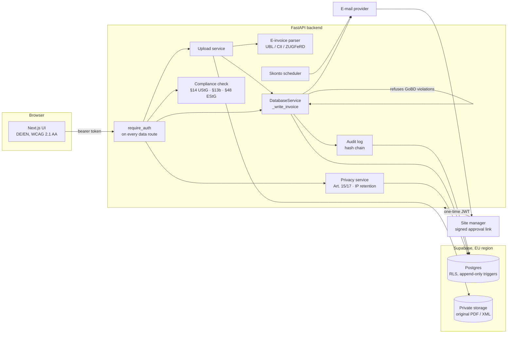

# Architecture

## Request path of an incoming invoice

1. **Upload** (`api/routes/upload.py` → `services/upload_service.py`): filename and type checks, duplicate check, then the e-invoice parser looks for EN 16931 XML (bare XRechnung or embedded in a ZUGFeRD/Factur-X PDF). Found values prefill the invoice.
2. **Storage**: the original file goes unchanged into a private bucket; the editor gets short-lived signed URLs.
3. **Editing**: the editor posts unsaved values to `/compliance-check` while the user types and shows findings with legal references.
4. **Every write** goes through `DatabaseService._write_invoice`, which refuses edits the GoBD forbid (locked after approval) and appends a diff to the hash-chained audit log.
5. **Approval**: the site manager receives a signed, expiring, single-use link; the decision is logged with their e-mail as actor.
6. **Retention**: deletion is refused for records under the 8-year retention period; tax auditors get a CSV/ZIP export (§147 Abs. 6 AO).

## Design decisions

| Decision | Why | Trade-off |
|---|---|---|
| Parse e-invoice XML instead of OCR when available | The XML is the legal invoice and exact | OCR still needed for paper |
| Compliance rules as pure functions | Easy to test (47 rule tests), easy to explain to auditors | Duplicate check needs the DB, so it lives in the route |
| One write path for invoices | Audit and lock can't be bypassed by a new endpoint | Write and log are two calls, not one transaction (see roadmap) |
| Hash chain plus DB triggers | Triggers stop accidental changes; the chain detects deliberate ones | Detection, not prevention, against a DB superuser |
| Router-level auth with a test over all routes | New routes are protected by default | Public routes must be listed explicitly |
| In-memory Supabase for tests and demo | Tests and demo run without accounts | Implements only the query subset the services use |

## Testing

- `backend/tests`: 230 tests, run in CI on every push and PR. No network, no Supabase: credentials are blanked before the app is imported.
- Frontend: lint, TypeScript and production build in CI; accessibility checked with axe-core against the running demo (see `docs/compliance/accessibility.md`).
